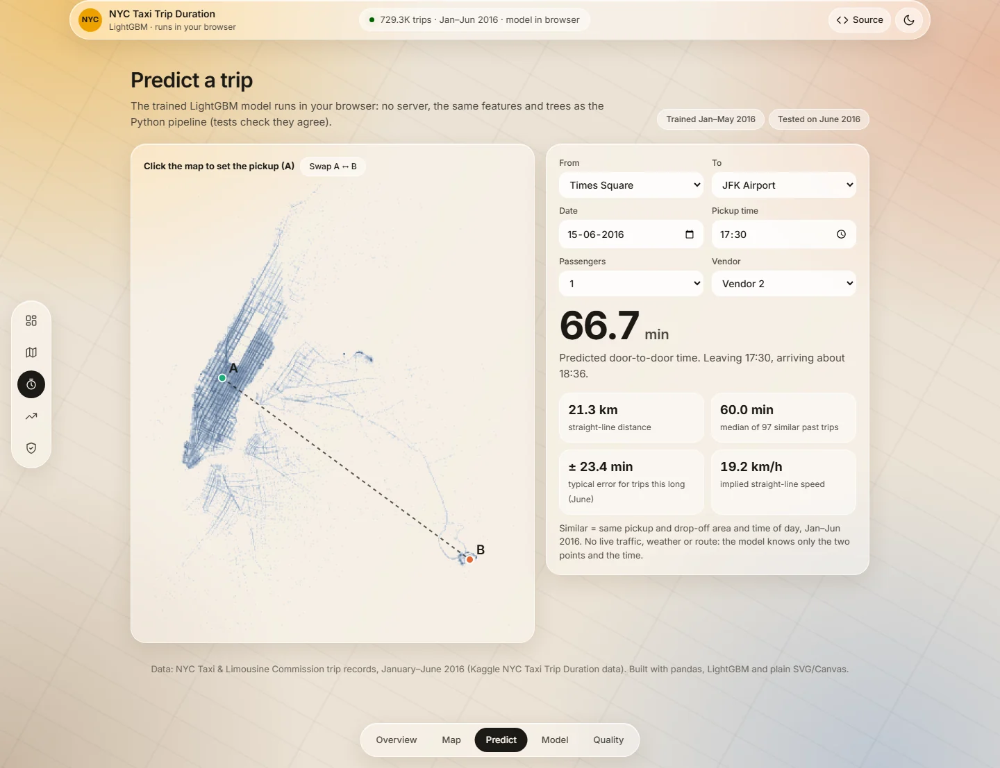
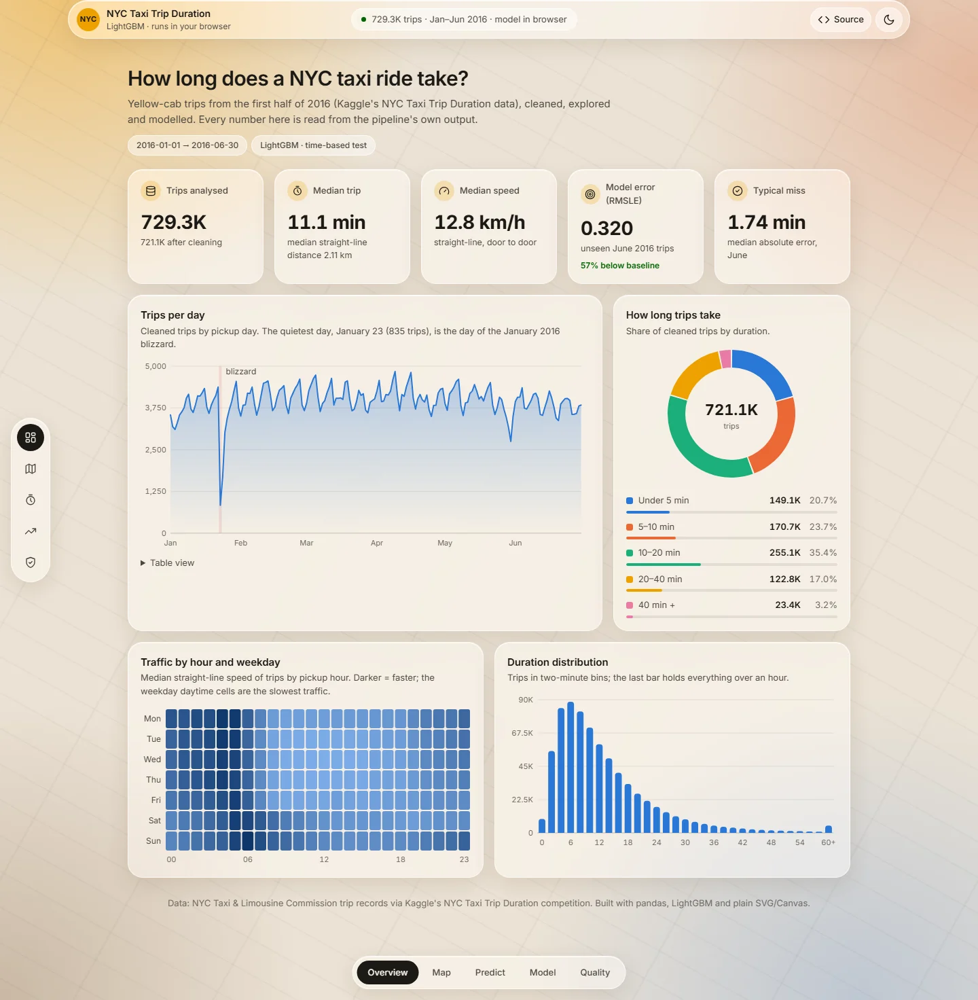
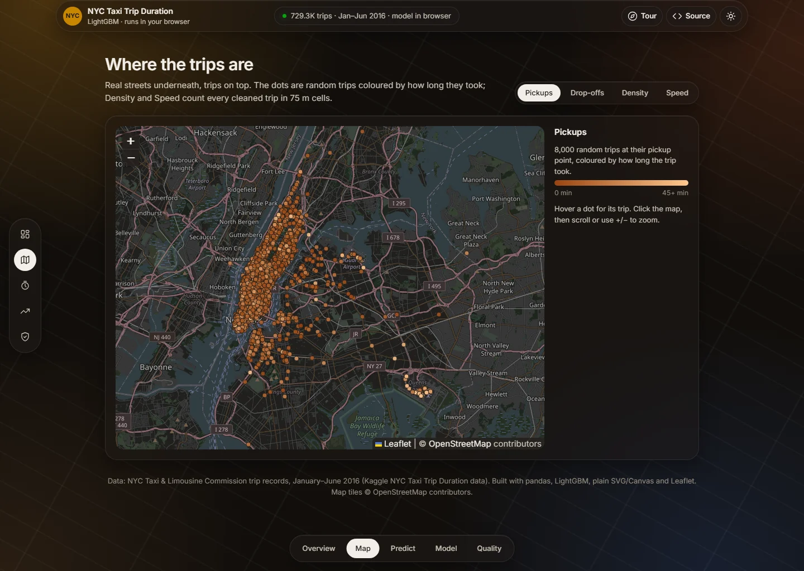
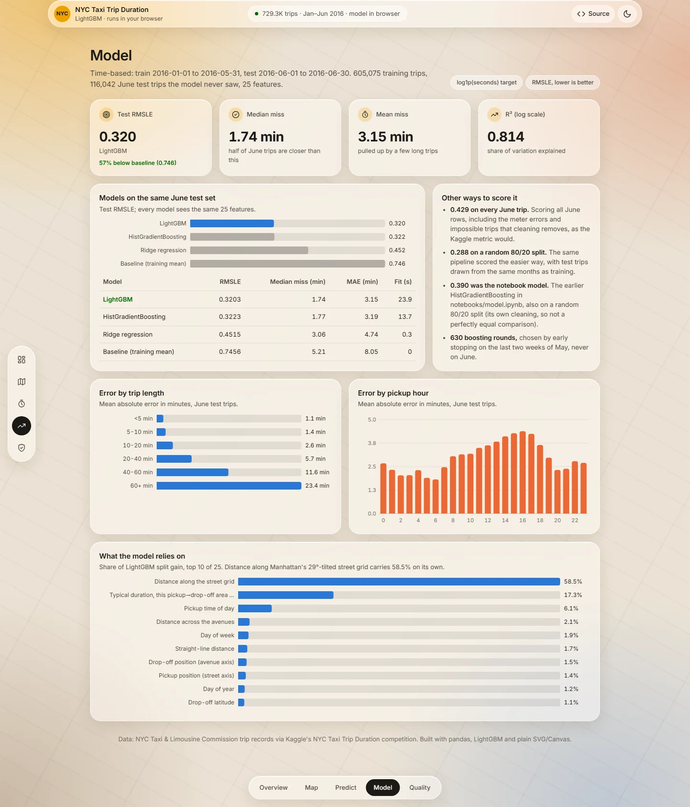
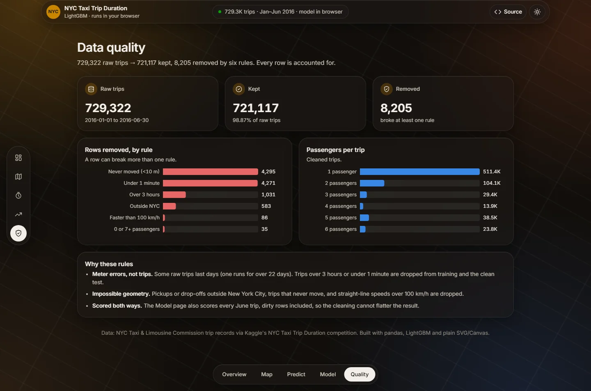

# NYC Taxi Trip Duration

How long will a New York yellow-cab ride take? This project cleans 729,322 trips from January to June 2016,
trains a LightGBM model that is tested on a month it never saw, and ships that exact model to a dashboard where
it runs in the browser.

**Live dashboard:** https://neilss170.github.io/nyc-taxi-trip-duration/ (overview, a street map of the trips,
an in-browser trip predictor, model results and data quality; plain HTML, SVG, Canvas and Leaflet)



<table>
  <tr>
    <td width="50%"><br><sub>Overview: daily trips, trip lengths, traffic speed by hour</sub></td>
    <td width="50%"><br><sub>Trip map: trips on OpenStreetMap, coloured by duration</sub></td>
  </tr>
  <tr>
    <td width="50%"><br><sub>Model: June test results and what the model relies on</sub></td>
    <td width="50%"><br><sub>Data quality: every removed row, by rule</sub></td>
  </tr>
</table>

## Results

The model is trained on January to May and scored on **every June trip** (116,042 after cleaning), so it is
judged on a month it has never seen. The target is `log1p(seconds)`, so the score is RMSLE, the metric of the
original Kaggle competition. All numbers come from [`reports/pipeline_metrics.json`](reports/pipeline_metrics.json).

| Model (25 features, same June test set) | Test RMSLE | Median miss | Mean miss | R² (log) |
|---|---|---|---|---|
| **LightGBM** | **0.320** | **1.74 min** | **3.15 min** | **0.814** |
| HistGradientBoosting | 0.322 | 1.77 min | 3.19 min | 0.812 |
| Ridge regression | 0.452 | 3.06 min | 4.74 min | 0.631 |
| Baseline (training mean) | 0.746 | 5.21 min | 8.05 min | 0.000 |

- **57.0% lower RMSLE** than the mean baseline; half of June trips are predicted within 1.74 minutes.
- **Distance along Manhattan's street grid** (avenues run 29° east of north) carries 58.5% of the model's split
  gain, far ahead of straight-line distance (1.7%). The typical duration for the pickup → drop-off area pair adds 17.3%.
- **Scored the hard way too:** on every June row, including the meter errors cleaning removes, RMSLE is 0.429.
- **Against the earlier notebook model:** on a random 80/20 split like `notebooks/model.ipynb`, the pipeline
  scores 0.288 against the notebook's 0.390 (the cleaning differs, so this is not a perfectly equal comparison).
- **Weak spot:** trips over an hour (1,173 in June) are off by 23.4 minutes on average; trips under 20 minutes
  by 1.1 to 2.6.

## The trip predictor

The Predict tab runs the trained model with no server. `python -m tripdur train` exports the LightGBM trees and
the fitted feature state (location clusters, target encodings) to `site/model/model.json`, and
[`site/predict.js`](site/predict.js) re-implements every feature in JavaScript. Every feature is something a
rider knows before the trip: two points, a pickup time, passengers and vendor.

The tests hold the two languages equal: on 300 June trips the Node-computed features match Python to 1e-12 and
the predictions to 1e-9. Next to each prediction the page shows the median of similar past trips (same pickup
and drop-off area, same time of day) and the June error for trips of that length.

## Pipeline

```text
data/nyc_taxi_trip_duration.csv          729,322 trips, Jan-Jun 2016
  → clean (6 rules)                      721,117 kept; 8,205 removed, counted per rule
  → split by time                        train Jan-May (605,075) | test June (116,042)
  → features (fit on training rows only) grid and straight-line distance, bearing, time, airports, holidays,
                                         out-of-fold smoothed encodings of 40 location clusters
  → models                               mean baseline, Ridge, HistGradientBoosting, LightGBM
                                         (rounds by early stopping on the last two weeks of May)
  → export                               site/model/model.json, reports/pipeline_metrics.json, site/data/*.json
```

Cleaning removes trips under 1 minute (4,271) or over 3 hours (1,031), trips that never move (4,295), pickups or
drop-offs outside New York City (583), straight-line speeds over 100 km/h (86) and 0 or 7+ passengers (35);
a trip can break more than one rule.

## Run it

Python 3.11. The full trip file is not in the repository (98 MB); save it as `data/nyc_taxi_trip_duration.csv`
with the same columns as the included sample, [`data/nyc_taxi_sample.csv`](data/nyc_taxi_sample.csv).

```powershell
py -3.11 -m venv .venv
.\.venv\Scripts\Activate.ps1
python -m pip install -r requirements.txt

$env:PYTHONPATH = "src"
python -m tripdur train        # clean, split, features, models, export (about 1 minute)
python -m tripdur site         # dashboard extracts in site/data
python -m pytest               # 12 tests, including the Python/JavaScript parity check (needs Node)
python -m http.server -d site  # the dashboard at http://localhost:8000
```

The tests need only the committed model and fixture, not the full data, and run in CI on every push.

### Notebooks and the Streamlit app

The notebooks are the exploratory history of the project: `eda.ipynb`, then `feature_engineering.ipynb`
(writes a random 80/20 split to `outputs/`), then `model.ipynb`, which compares five regressors on it and saves
[`reports/model_metrics.json`](reports/model_metrics.json) (best: HistGradientBoosting, RMSLE 0.390). The
pipeline above replaced that approach with a time-based test and features the browser can compute.

The original filterable Streamlit dashboard still runs on the 25,000-row sample after cloning:

```powershell
python -m streamlit run dashboard\app.py
```

## Project structure

```text
src/tripdur/   pipeline: config, cleaning, features, training, model export, dashboard extracts
site/          static dashboard (GitHub Pages): index.html, predict.js, model/, data/
tests/         cleaning, features (no target leakage), export and Python/JavaScript parity
notebooks/     EDA, feature engineering and the notebook model comparison
dashboard/     Streamlit app on the included sample
reports/       pipeline and notebook metrics, written reports
docs/          README screenshots
```

## Limitations

- Distances are straight-line and grid approximations of the driven route; there is no routing, live traffic,
  weather or road-closure data. Adding OSRM route distances is the obvious next step, but the predictor would
  then need a routing service.
- One city, six months of 2016: the model has not seen other seasons or years, and the dashboard limits dates
  to January–June 2016.
- Long trips are predicted poorly (see the error by trip length on the Model page).
